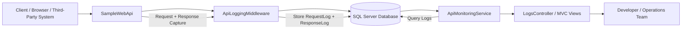
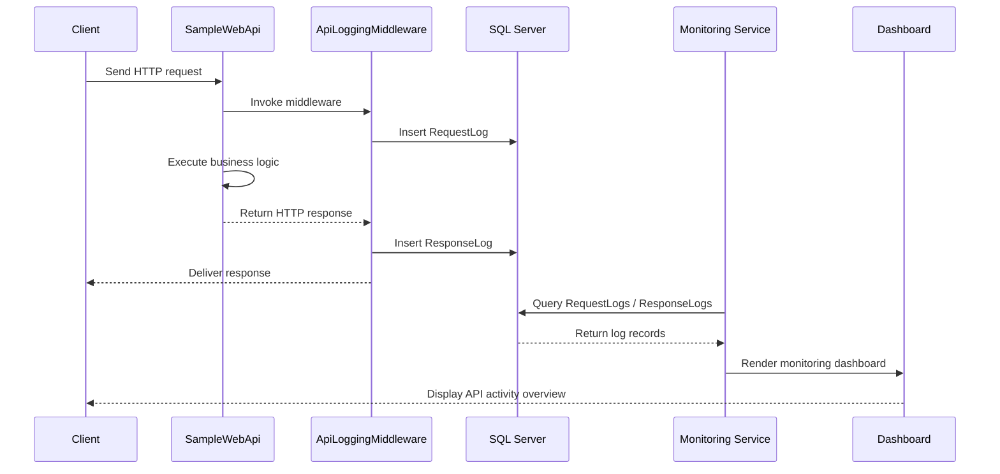

<!--
SEO Meta
<title>Full Featured API Monitoring Service in ASP.NET Core MVC, Dapper, and SQL Server</title>
<meta name="description" content="Full featured API monitoring service built with ASP.NET Core MVC, Dapper, SQL Server, and request/response logging for modern API observability and debugging." />
<meta name="keywords" content="API monitoring service, ASP.NET Core API monitoring, API logging dashboard, Dapper SQL Server monitoring, .NET API observability, API health monitoring, API request response logging, developer API monitoring" />
-->

# Full Featured API Monitoring Service

A professional API observability and monitoring solution built with ASP.NET Core MVC, Dapper, and SQL Server. This repository demonstrates how to capture API requests, responses, endpoint usage, payloads, IP addresses, and timing information for debugging, monitoring, and operational visibility.

<p align="center">
  
  
  
  
  
</p>

## Why this project matters

Modern applications depend on APIs for business logic, integrations, and customer experiences. When things go wrong, teams need more than raw server logs. This project provides a structured API monitoring layer that tracks:

- HTTP methods and endpoints
- Request payloads and response payloads
- Status codes and error responses
- Client IP addresses
- Response times and request timestamps
- Historical API logs for troubleshooting

This makes it a valuable solution for developers, QA teams, and operations engineers who need visibility into how APIs behave in production or staging environments.

## Project overview

This repository includes two main components:

1. SampleWebApi
   - A sample ASP.NET Core Web API that logs each incoming request and outgoing response.
2. ApiMonitoringService
   - An ASP.NET Core MVC monitoring dashboard that reads monitored logs from SQL Server and presents them for review.

## Data flow diagram



## Sequence diagram



## Architecture

The solution follows a simple and effective layered design:

- Web API layer: handles real API traffic
- Middleware layer: intercepts requests and responses
- Data layer: stores logs in SQL Server using Dapper
- Monitoring layer: reads logs and displays them in ASP.NET Core MVC views

## Benefits

- Better API observability: track requests and responses end-to-end.
- Faster debugging: inspect payloads and status codes without relying only on app logs.
- Performance awareness: identify slow endpoints and unexpected traffic patterns.
- Security and auditing: keep traceable request history with client IP information.
- Operational visibility: help support and engineering teams investigate incidents faster.
- Easy integration: works well with .NET applications using ASP.NET Core and SQL Server.
- Developer-friendly: clear structure, simple architecture, and easy extension points.

## Use cases

- Monitoring internal business APIs
- Tracking third-party integration traffic
- Debugging failed requests during deployment
- Auditing request payloads for compliance scenarios
- Reviewing endpoint behavior in staging and production environments
- Building a lightweight API observability dashboard for small to medium teams
- Learning how middleware-based logging works in ASP.NET Core

## Features

- Request logging with method, endpoint, IP, time, and payload
- Response logging with status code, payload, and timestamp
- SQL Server storage with Dapper-based data access
- ASP.NET Core MVC-based monitoring dashboard
- Simple architecture suitable for learning and extension
- Works as a sample project for API observability patterns in .NET

## Repository structure

```text
Full-Featured-API-Monitoring-Service/
├── ApiMonitoringService/
│   ├── Controllers/
│   ├── Data/
│   ├── Models/
│   ├── Services/
│   ├── Views/
│   ├── Program.cs
│   ├── appsettings.json
│   └── ApiMonitoringService.csproj
├── SampleWebApi/
│   ├── Services/
│   ├── Data/
│   ├── Models/
│   ├── Program.cs
│   ├── appsettings.json
│   └── SampleWebApi.csproj
├── ApiMonitoringService.sln
├── README.md
└── .gitignore
```

## Tech stack

- ASP.NET Core MVC
- ASP.NET Core Web API
- C#
- Dapper
- SQL Server
- Microsoft.Data.SqlClient

## Getting started

### Prerequisites

- .NET SDK 8.0 or later
- SQL Server instance
- A configured connection string in appsettings.json

### Configure database connection

Update the connection string in the relevant appsettings.json file to point to your SQL Server instance.

### Run the sample API

```bash
dotnet restore
dotnet build
dotnet run --project SampleWebApi
```

### Run the monitoring dashboard

```bash
dotnet run --project ApiMonitoringService
```

## Example monitoring flow

1. A client sends a request to the API.
2. ApiLoggingMiddleware captures the request details.
3. The request log is stored in the RequestLogs table.
4. The API processes the request and returns a response.
5. The middleware stores the response log in the ResponseLogs table.
6. The monitoring service reads and displays the records for troubleshooting and analysis.

## Related article

For a detailed walkthrough, visit:

- https://medium.com/@hasanmcse/building-a-full-featured-api-monitoring-service-with-c-asp-net-mvc-and-dapper-eb080494c916

## SEO keywords for search visibility

API monitoring service, ASP.NET Core API monitoring, full featured API monitoring service, Dapper SQL Server logging, .NET API monitoring dashboard, API observability, request logging in ASP.NET Core, response logging service, API health monitoring, .NET monitoring solution, API audit logging.

## License

This project is open source and available under the MIT license.

## Contributing

Contributions, ideas, and improvements are welcome. Feel free to fork the project, open an issue, or submit a pull request.

## Author

Hasan Monsur

---

This repository is designed to help developers understand how to build a practical API monitoring and logging layer using ASP.NET Core, Dapper, and SQL Server in a clean, maintainable, and production-oriented way.
